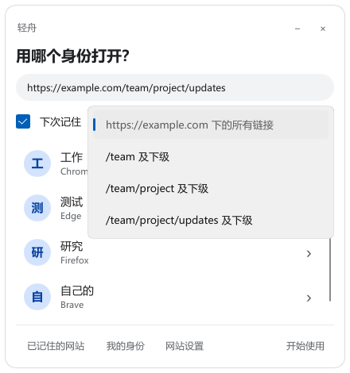
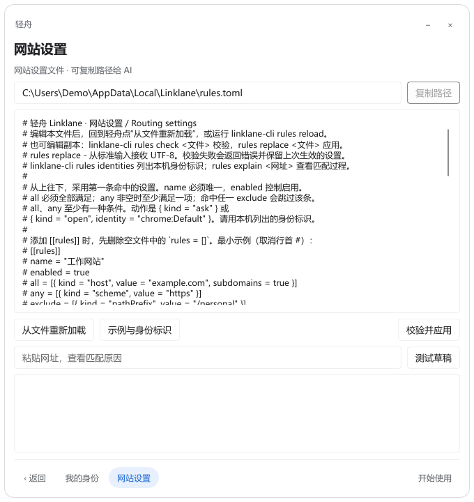
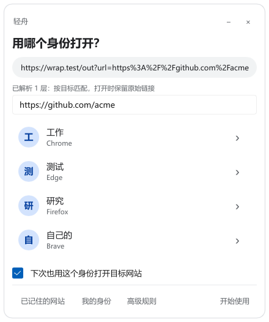

# 轻舟 Linklane

A compact Windows link chooser with browser identities and explainable routing rules.

轻舟把外部链接交给合适的浏览器身份。设为 Windows 默认 HTTP/HTTPS 处理程序后，点击邮件、聊天或编辑器里的链接，就能选择 Chrome、Edge、Brave 或 Firefox 的身份，也能让规则自动决定。



*截图使用演示身份。日常选择器保持紧凑，高级规则按需展开。*

## 功能

- **多个浏览器，一张身份列表**：自动发现标准安装位置的 Chrome、Edge、Brave、Firefox 稳定版。每张卡片显示身份和浏览器，最近使用优先，支持独立重命名。
- **选择记住范围**：“下次记住”默认勾选。轻舟根据网址提供整个来源（协议、域名和端口）及各级路径选项。比如 `/team/project` 会给出 `/team` 和 `/team/project`；选中某级路径，也会记住它下面的链接。选好范围后，点击要用的身份。
- **网站设置**：底部打开 TOML 编辑器，可以复制文件路径给 AI。支持按域名及子域、协议、端口范围、路径、查询参数或完整网址匹配。
- **明确优先级**：第一条命中决定打开身份或询问。“每次都让我选”可暂停自动打开；目标身份暂不可用时显示原因并交回选择器。
- **先测试再应用**：草稿测试显示逐条匹配原因。外部编辑后选择“从文件重新加载”，或通过 `linklane-cli` 校验并应用；遇到错误时继续使用上次生效的设置。
- **识别 query 跳转目标**：从 `url`、`target` 等参数逐层解析目标，按目标选择身份，实际打开保留原链接的中转流程。支持自定义参数名和域名例外；选择器显示目标，“测试草稿”展示完整解析链。
- **本地运行**：仅读取浏览器身份元数据。自动记住时仅保存选中范围所需的网站或路径前缀；查询参数和页面锚点不写入。测试网址仅留在当前窗口。退出窗口后结束进程。

详细语法与示例见 [高级规则说明](docs/RULES.md)，应用内“示例与身份标识”同时列出本机可复制的身份标识。





## 安装与使用

公开发布包见 [GitHub Releases](https://github.com/pluveto/linklane/releases/latest)。请下载 Windows x64 ZIP，里面包含主程序、命令行工具、文档、许可证与卸载脚本。

1. 解压并运行 `linklane.exe`。
2. 点击“开始使用”，安装至 `%LOCALAPPDATA%/Linklane/bin` 并完成系统注册。可编辑的网站设置在 `%LOCALAPPDATA%/Linklane/rules.toml`。
3. 在 Windows“默认应用”中搜索“轻舟 Linklane”，设为默认浏览器，关联 HTTP 与 HTTPS。

运行需要 Windows x64；安装按当前用户进行。当前构建使用未签名可执行文件。更新采用手动替换安装。

## 支持范围

- Chromium 家族从各自 `User Data/Local State` 发现身份；Firefox 从 `%APPDATA%/Mozilla/Firefox/profiles.ini` 发现相对或绝对路径的身份。
- 当前覆盖标准位置的稳定版安装。便携版、自定义安装路径、多个发行通道和 Firefox Container 标签页留待后续支持。
- 经过 Windows HTTP/HTTPS 关联的外部链接参与路由；浏览器内跳转、应用内 WebView 和强制指定浏览器的链接由对应应用处理。
- 当前条件基于 URL。来源应用、快捷键修饰符及时间段尚未加入条件类型。

## 升级与回滚

关闭旧窗口，将新版 ZIP 完整解压，再运行新版主程序并点“开始使用”。v0.4 使用新的 TOML 文件；旧 `settings.json` 留在原处备份。需要沿用旧规则时，可参照新 `rules.toml` 顶部注释，把旧文件中的 `rules` 和 `resolution` 转写到 TOML 草稿，校验后应用。v0.1 的 `sites` 每项可改写为 `origin` 条件和 `open` 动作。

回滚时：关闭所有轻舟窗口，恢复对应旧程序及该版本的 `settings.json`。v0.4 的改动留在 TOML 文件中。

## 卸载

在 Windows 默认应用中选择接管链接的浏览器，关闭轻舟，然后运行随包的 `uninstall.ps1`。卸载保留本地配置。

## 开发与验证

Rust 1.96.0，Slint 1.18.1。

```powershell
cargo run -- --demo
cargo run -- --list-identities
cargo run -- --explain https://example.com/project
cargo run -- --dry-run https://example.com
cargo fmt --all -- --check
cargo clippy --locked --all-targets -- -D warnings
cargo test --locked --all-targets
./scripts/package.ps1 -Tag v0.4.0
```

`--demo` 使用内存中的演示身份与规则。`--dry-run`、`--explain` 只输出决策；`--choose URL` 强制显示选择器。`LINKLANE_HOME` 可指定独立的测试设置目录。Slint MCP 界面检查用 `--features slint/mcp` 单独构建，正式包省略此功能。

测试覆盖多浏览器身份隔离、组合条件、跳转解析、无效 TOML 回退、草稿冲突和并发保存。CI 执行格式检查、Clippy、测试以及命令行打包验证；推送 `v*` 标签发布匹配版本的安装包。

## 许可证

GPL-3.0-only。
